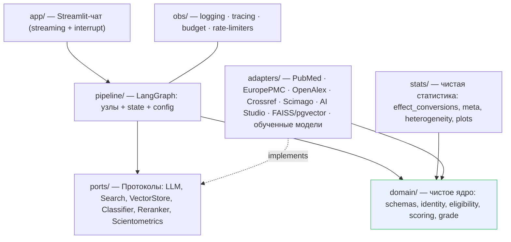
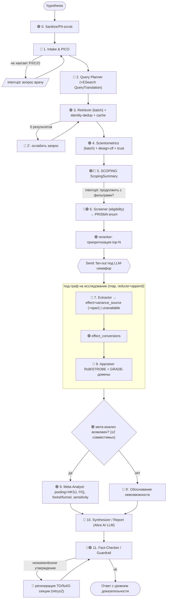

# План решения — Трек 3: AI-ассистент для научных исследований в онкологии

> Хакатон **«Цифровое здоровье»** (НМИЦ онкологии им. Н.Н. Петрова + ITMO).
> Дедлайн: **04.07.2026**. Репозиторий: Sourcecraft. Обучение моделей: **обязательно в Yandex Cloud**.
> **Ревизия v3** — приоритет качества решения (объём не лимитирует), модели через AI Studio API, учтено независимое ревью. См. §0.2.
>
> **Ревизия v4 (30.06.2026) — ОНЛАЙН-РЕЖИМ ЭТО ОСНОВНАЯ ФИЧА.** Финальный продукт, который
> мы защищаем и объясняем на питче, — **живой/онлайн прогон** (реальный PubMed + реальный LLM
> AI Studio), воспроизводящий опубликованный Cochrane-обзор. **Оффлайн-часть** (`StubLLM`,
> `FrozenSearch`, frozen-eval, canned-сценарий ИИ-судьи) — это **временные леса только для
> проверки корректности; их планируется полностью удалить.** Поэтому где ниже написано
> «offline-first / контракт ИИ-судьи / frozen-eval» — читать как вспомогательное тестовое, не
> как цель. Юнит-тесты чистых функций (`stats/`, `domain/`) остаются как страховка математики.

---

## 0. TL;DR

Мультиагентная система на **LangGraph** со **слоистой (гексагональной) архитектурой**: принимает **гипотезу врача** → структурирует в **PICO** → ищет публикации (**PubMed + Europe PMC + OpenAlex**) → даёт **scoping-обзор как явный чекпойнт** → отбирает по критериям (**PRISMA**) → наукометрически **взвешивает доверие** → извлекает численные эффекты (**с честной семантикой «не сообщено» + детерминированные конверсии**) → оценивает качество (**RoB 2.0 / ROBINS-I / STROBE + GRADE**) → при возможности **мета-анализ** (forest/funnel, I²) → **проверяемый ответ с уровнем доказательности** (не бинарный вердикт), со ссылками и разделением «факт/интерпретация».

**Принципы (качество > широта функций):**
1. **Слои + правило зависимостей** (domain ← ports ← adapters; всё внутрь) → модули независимо тестируемы и заменяемы.
2. **LLM за портом `LLMPort`** (OpenAI-совместимый) → модели **AI Studio** свопаются по URI; **self-host не нужен**.
3. **Детерминизм ≠ генерация** → статистика, конверсии эффектов, eligibility, scoring, identity — **чистые функции** (`domain/`, `stats/`); LLM извлекает и формулирует.
4. **Корректность важнее количества фич** → лучше меньше модулей, но каждый правильный и протестированный; качество **измеряется** (frozen-eval против опубликованного Cochrane-обзора).
5. **Честность к неопределённости** → «не сообщено» вместо угаданного числа; градуированная доказательность вместо самоуверенного вердикта.

### 0.1 Исправлено в v2 (история)
God-object→reducers; eligibility≠trust; порты+правило зависимостей; eval-харнесс; детерминизм; PII/prompt-injection; tool-node vs llm-node; budget/observability.

### 0.2 Изменено в v3 (после независимого ревью + находки по AI Studio)

| Что | Изменение | Раздел |
|---|---|---|
| **Извлечение чисел из абстрактов** — несущая зависимость без решения | Схема `Extraction` с семантикой **`unavailable` + `variance_source`** + детерминированный **`stats/effect_conversions.py`** (CI↔SE, 2×2→OR/RR с коррекцией нулевой ячейки, p→SE) | §4, §8 |
| Модели через self-host vLLM на GPU | **Только AI Studio OpenAI-API** (Qwen3.6 35B / Qwen3 235B / DeepSeek V4 Flash / Alice AI LLM). Ноль self-host, GPU только под обучение малых моделей | §5, §12 |
| Fan-out без ограничителя → 429 | **Ограничители конкурентности** (token-bucket per-host + LLM-семафор) в `Deps`; батч ДО fan-out | §3, §4 |
| «Живой PubMed» ⟂ воспроизводимость; `temp=0`≠детерминизм | **Frozen vs live eval**; единый замороженный корпус для eval-gold и canned-демо; детерминизм = **кэш ответов** | §10 |
| Дедуп ≈ упомянут | **`domain/identity.py`** (DOI→PMID→PMCID→fuzzy) против двойного счёта | §4, §6 |
| Scoping растворён в графе | **Явный `ScopingSummary` + узел-чекпойнт** (этап-1 → этап-2) | §3 |
| Streamlit фризит долгий граф | **`astream_events`-стриминг + `interrupt()`** для уточнения PICO | §12 |
| Модель A — скрытая циркулярность | Переформулирована: «ценность там, где PT молчит»; **human-checked gold**; реалистичный таргет | §7 |
| Fact-checker — петля без границы | Регенерация **только секции** отчёта, `recursion_limit`, retry ≤2 | §3, §9 |
| Статистика заявлена шире реального | Поддержка: бинарный + пред-сообщённый HR; **Hartung-Knapp** при малом k; матрица совместимости мер; KM-реконструкция → out | §8 |
| Бинарный «вердикт по гипотезе» | **Градуированная доказательность** (направление+сила+уверенность) — против сверхуверенности | §9 |
| RAG-стек для абстрактов | Реранкер = **приоритизатор кандидатов**; полный vector-стек — на **full-text** (качество, за флагом) | §6 |

---

## 1. Цель и критерии успеха

**Цель:** рабочий прототип-чат для врача-онколога: *гипотеза → проверяемый вывод* с обоснованием через scoping/систематический/мета-анализ.

Карта «фича → баллы» (100):

| № | Критерий | Балл | Чем закрываем |
|---|---|---|---|
| 1 | Полнота исследовательского сценария | 15 | Сквозной граф гипотеза→ответ + стриминг прогресса + frozen-eval |
| 2 | Поиск, отбор, проверяемость источников | 15 | PubMed/EuropePMC/OpenAlex, DOI/PMID, **identity-резолюция**, верификация ссылок, ESearch QueryTranslation, причины вкл./искл. |
| 3 | Scoping review | 10 | **Явный scoping-чекпойнт**: типы публикаций, популяции, исходы, пробелы |
| 4 | Систематический обзор | 15 | PICO, eligibility-критерии, PRISMA (enum-причины), таблица, оценка качества |
| 5 | Мета-анализ / проверка возможности | 10 | **effect_conversions** → пул; forest/funnel, I²/Q/τ², Egger, HKSJ; либо обоснование невозможности |
| 6 | Критическая оценка качества/доказательности | 10 | RoB 2.0 (по доменам) / ROBINS-I / STROBE + **GRADE** + sensitivity по RoB |
| 7 | Качество ответа и снижение рисков LLM | 10 | Заземление, провенанс, **`unavailable` вместо выдумки**, факт/интерпретация, градуированная уверенность |
| 8 | UX/UI для врача | 5 | Streamlit-чат со стримингом, scoping-чекпойнт, вкладки источники/таблица/графики/PRISMA |
| 9 | Код, архитектура, воспроизводимость | 5 | Слои, порты, кэш ответов, пины версий, frozen-eval, тесты |
| 10 | Презентация | 5 | 5–7 мин: проблема → архитектура → демо (Cochrane-репро + разреженный кейс) → ограничения |

---

## 2. Архитектура — слои и правило зависимостей

Гексагональная (ports & adapters). **Правило:** зависимости указывают **внутрь**; `domain` не зависит ни от чего; адаптеры **реализуют** порты.



- **`domain/`** — чистые типы + логика без I/O: `schemas`, `identity` (резолюция дублей), `eligibility`, `scoring` (trust), `grade`.
- **`stats/`** — чистый движок: `effect_conversions`, `meta`, `heterogeneity`, `plots`.
- **`ports/`** — Протоколы. **`adapters/`** — реализации (заменяемы). **`pipeline/`** — оркестрация (зависит от портов, не адаптеров; DI через `Deps`). **`app/`** — Streamlit. **`obs/`** — наблюдаемость + ограничители (cross-cutting).

---

## 3. Пайплайн (LangGraph) — узлы и потоки

🟢 deterministic tool-node · 🔵 LLM-node. Реранкер — вызов внутри `retrieval`, не узел.



**Особенности:**
- **Scoping-чекпойнт (узел 5):** детерминированная агрегация над candidates + design-clf → `ScopingSummary` (сколько публикаций, разбивка по типам, исходы, популяции, пробелы) → `interrupt()`: «продолжить систематический обзор с фильтрами X?». Реализует постановку «этап-1 → этап-2» и даёт UX-чекпойнт.
- **Checkpointer** (Sqlite) + `thread_id` → резюмируемость, human-in-the-loop без потери state.
- **Fan-out под LLM-семафором** (не «всё сразу»): bounded concurrency (конфиг `llm_max_concurrency`); reducer=append → без гонок.
- **Деградация:** каждый узел в try → ошибка источника/исследования = `skipped+reason`, пайплайн не падает.
- **Fact-checker:** неподтверждённое утверждение → **выкинуть/флагировать + регенерировать только секцию** (retry ≤2, `recursion_limit`), не реэкстракт.
- **Ограничители:** token-bucket per-host (NCBI 10 rps, OpenAlex polite) + семафор на AI Studio; **батч ДО fan-out** (efetch ~200 PMID / epost).

---

## 4. Контракты модулей

**Узел** возвращает частичный апдейт (не мутирует state):
```python
class Node(Protocol):
    name: str
    async def __call__(self, state: ResearchState, deps: Deps) -> StateUpdate: ...
```
`Deps` = внедрённые порты + **ограничители** (`RateLimiter` per-host, `Semaphore` LLM) + кэш. Узлы об ограничителях не знают — они в адаптерах/`Deps` (сохраняет правило зависимостей).

**Порт LLM — типизированный исход** (провал схемы — не исключение, а результат → для retry/деградации):
```python
class LLMPort(Protocol):
    async def complete(self, msgs, *, schema: type[T] | None,
                       temperature=0.0, model_role="workhorse") -> Result[T] | SchemaError: ...
```

**Состояние с reducer'ами:**
```python
class ResearchState(TypedDict):
    raw_hypothesis: str
    pico: PICO | None
    queries: list[Query]
    candidates: Annotated[list[Source], identity_dedup_reducer]
    scoping: ScopingSummary | None          # явный артефакт этапа-1
    screening: Annotated[list[ScreenDecision], operator.add]
    prisma: PrismaCounts
    extractions: Annotated[list[Extraction], operator.add]
    appraisals: Annotated[list[Appraisal], operator.add]
    meta: MetaResult | Infeasible | None
    report: Report | None
    provenance: Annotated[list[Claim], operator.add]
    audit: Annotated[list[Event], operator.add]
```

**Ключевые схемы `domain/schemas.py`:**
```python
class Extraction(BaseModel):
    source_id: str
    design: StudyDesign
    effect_type: Literal["HR","OR","RR","MD","SMD"] | None
    point: float | None; ci_low: float | None; ci_high: float | None; se: float | None
    n_arm1: int | None; n_arm2: int | None; events1: int | None; events2: int | None
    outcome: str; comparison: str
    variance_source: Literal["reported_ci","reported_se","derived_2x2","derived_p","unavailable"]
    extraction_confidence: float
    evidence_span: str            # дословная цитата-обоснование
    text_source: Literal["abstract","full_text"]
```
> Контракт между Extractor (узел 7) и мета-gate (§8): LLM **обязан** вернуть `unavailable`, а не угадывать. `effect_conversions` восстанавливает дисперсию там, где возможно.

**Чистые модули-включатели:** `stats/effect_conversions.py` (CI↔SE в лог-пространстве; 2×2→OR/RR + Woolf SE с **+0.5 при нулевой ячейке**; p→SE), `domain/identity.py` (порядок: DOI→PMID→PMCID→fuzzy title+year+journal). Оба тестируются табличными фикстурами без сети.

**Config-driven (`pipeline/config.py`)** — флаги качества/глубины:
```
models: {workhorse, reasoning, ru, fallback}   # URI AI Studio
vector_backend: faiss | pgvector
enable_fulltext_mining: bool        # OA full-text → RAG/reranker (качество)
enable_screening_clf: bool          # обученная модель C
enable_reasoning_escalation: bool   # тяжёлые шаги на Qwen3 235B
eval_mode: frozen | live
max_deep_studies: int = 15
llm_max_concurrency: int = 6
```

---

## 5. Стратегия LLM (AI Studio, только API)

**Меню AI Studio подтверждено (июнь 2026), всё OpenAI-совместимо → `LLMPort` ложится 1:1, self-host не нужен.** Свитч роли = другой URI.

| Роль | Модель | URI | Контекст |
|---|---|---|---|
| **workhorse** (intake, query, screen, extract, fact-check — высокочастотные) | **Qwen3.6 35B A3B** (MoE, мультимодальная) | `qwen3.6-35b-a3b` | 256k |
| **reasoning** (appraisal, интерпретация мета, GRADE) | **Qwen3 235B** | `qwen3-235b-a22b-fp8` | 256k |
| **ru** (финальный отчёт) | **Alice AI LLM** | `aliceai-llm` | 128k |
| long-context синтез по многим full-text | **DeepSeek V4 Flash** | `deepseek-v4-flash` | 1M |
| fallback / дообучаемый | **YandexGPT 5 Lite** | `yandexgpt-5-lite` (`/yandexgpt-lite/latest@<суффикс>`) | 32k |

> Приоритет качества: тяжёлые шаги по умолчанию на **Qwen3 235B** (`enable_reasoning_escalation`), высокочастотные — на быстром MoE **35B A3B**. DeepSeek через AI Studio хостится **внутри Yandex** → data residency ок.

- **Детерминизм/воспроизводимость:** `temperature=0` (гигиена) + **кэш ответов** (`hash(model_uri, prompt, params, template_version)`) — именно кэш гарантирует повтор, не температура.
- **Конфиденциальность (мед-данные):** в AI Studio **отключить логирование запросов** (документация прямо рекомендует при чувствительных данных).
- **Стабильность:** использовать **явные URI** (не `/latest`) — модели депрекейтятся с уведомлением (как DeepSeek V3.2).
- **Гигиена:** `response_format=json` + Pydantic-валидация + ретрай; промпты по ролям в `adapters/llm/prompts/`.

---

## 6. Поиск, идентичность и наукометрия

### 6.1 Источники
| Источник | API | Что берём | Ключ |
|---|---|---|---|
| **PubMed** | E-utilities (esearch/efetch/epost) | PMID, абстракт, Publication Types, MeSH, журнал, **QueryTranslation** | NCBI API key (10 rps) |
| **Europe PMC** | REST | **OA full-text** (для извлечения), цитирования | — |
| **OpenAlex** | works/sources (batch) | цитируемость, venue, OA, концепты | polite pool (email) |
| **Crossref** | REST | метаданные DOI, **флаг ретракции** | — |
| **Scimago SJR** | CSV (в репо) | квартиль журнала Q1–Q4 | офлайн |
| Unpaywall | REST (опц.) | локатор OA full-text | email |

**Прозрачность поиска (крит. 2):** показываем `QueryTranslation` от ESearch — PubMed сам мапит запрос в MeSH и возвращает трансляцию.
**Язык:** запросы/извлечение — EN; отчёт — RU.

### 6.2 Идентичность и дедуп
`domain/identity.py`: нормализация DOI (lowercase, срез версии), матч PMID↔DOI↔PMCID, fuzzy title+year+journal при отсутствии общего ID. **Критично против двойного счёта в мета-анализе** (методическая ошибка, видимая клиническому судье).

### 6.3 Eligibility ≠ Trust
- **Eligibility (Screener):** вкл./искл. по PICO + критериям типа исследования + ретракция → **PRISMA** (причины — **фиксированный enum**: `wrong_population/intervention/outcome/study_type, not_english, retracted, duplicate, no_extractable_data`).
- **Trust score (0–100, прозрачная разбивка):** `design(35) + quartile(25) + citation(20) + recency(10) + sample(10) − penalties`. Влияет на **порядок, GRADE и sensitivity-анализ**, **не исключает** (кроме ретракций) и **не задаёт веса пулинга**.

### 6.4 RAG (качество, за флагом)
- **Реранкер (модель B)** = приоритизатор кандидатов: cross-encoder `query×abstract` → top-N в `max_deep_studies` (абстракт-only, осмысленно).
- **Full-text mining** (`enable_fulltext_mining`): OA full-text (Europe PMC/Unpaywall) → чанкинг + **bge-m3** (dense+sparse) → гибрид BM25+dense → реранкер → контекст для извлечения. **Поднимает извлекаемость эффектов** (full-text часто содержит HR/ДИ, которых нет в абстракте) → прямой вклад в крит. 4/5.

---

## 7. 🎓 Обучение в Yandex Cloud (обязательное требование)

Обучаем **малые модели** в **DataSphere**, чекпойнты — **Object Storage**, инференс — через `ClassifierPort`/`RerankerPort`. Засчитывается любой компонент.

| # | Модель | Назначение | База | Метрика |
|---|---|---|---|---|
| **A** | Классификатор дизайна — **«ценность там, где PT молчит»** (записи без Publication Type, тонкие различия prospective/retrospective, не-PubMed источники) | scoping (3), trust (6.2), appraisal (6) | `PubMedBERT` / `e5` | per-class F1 на **human-checked gold (50–100)**, цель 0.7–0.8 |
| **B** | Реранкер / приоритизатор кандидатов | RAG, отбор (2,7) | `bge-reranker-v2-m3` | nDCG@10 ↑ |
| **C** | Скрининг-классификатор (include/exclude) | eligibility (4) | bi-encoder + LR / e5 | recall ≥ 0.95 (не терять РКИ) |

- **День 1 — забанковать требование сразу:** минимальный артефакт (LR-голова на замороженных эмбеддингах, обучается минуты в DataSphere-ноутбуке) → обязательное «обучено в YC» закрыто; затем апгрейд A до PubMedBERT.
- **Честная оценка:** метрики на human-checked gold, не на авто-метках (PT/MeSH шумные) — честный отчёт метрик сам по себе балл по крит. 9.
- **Запасной путь:** managed-дообучение `yandexgpt-lite` (`@суффикс`) — ещё один «train in YC», если захотим тюнить генеративную.
- **Дельверабл:** `training/*.ipynb` + датасеты/чекпойнты в Object Storage + отчёт метрик (на питч).

---

## 8. Мета-анализ (детерминированный, `stats/`)

**Включатель — `effect_conversions`:** CI↔SE (лог-пространство для ratio), 2×2→OR/RR + Woolf SE с **+0.5 при нулевой ячейке**, p+estimate→SE. Кратно расширяет пул пулируемых исследований.

**Gate возможности:** ≥2 исследования, **совместимые** меры (матрица: нельзя пулить HR с OR; RR↔OR не конвертируется без базового риска), один исход+сравнение, извлекаемая дисперсия, клиническая однородность. Иначе → структурное «почему нельзя» + чего не хватает (баллы по крит. 5).

- **Поддерживаемые меры:** бинарные (events/N → OR/RR) и **пред-сообщённый HR** (logHR+SE). SMD/MD — только если есть mean+SD+N; **KM-реконструкция — out** (ненадёжно). Нормализация направления (HR<1 = в пользу терапии).
- **Пулинг:** fixed (inverse-variance) + random (DerSimonian–Laird) **+ Hartung-Knapp-Sidik-Jonkman** поправка ДИ при малом k (k=2–5 у нас типично).
- **Гетерогенность:** Q (χ²), **I²**, τ². **Смещение:** funnel + Egger (только ≥10 исследований).
- **Sensitivity (качество):** leave-one-out; подгруппа по RoB (исключить high-RoB) → влияет на GRADE.
- **GRADE:** High/Moderate/Low/Very low; понижение за RoB, несогласованность (I²), косвенность (abstract-only ↑), неточность (ширина ДИ), публикационное смещение.
- **Графики:** forest (+ромб пула), funnel — `matplotlib`/`forestplot`. **Стек:** statsmodels, scipy, PythonMeta/pymare, numpy.

---

## 9. Надёжность: гардрейлы, безопасность, провенанс (крит. 7 + ETHICS)

- **Никаких выдуманных чисел/ссылок:** `unavailable`-семантика на извлечении; каждый DOI/PMID верифицируется (Crossref/PubMed) — не подтвердился → выкинуть/флагировать.
- **Provenance store:** `Claim{text, type: fact|interpretation, source_id, span, verified}`; отчёт рендерит **только verified-факты**; каждое число трассируется к `Extraction` со спаном.
- **Факт vs интерпретация:** раздельные секции.
- **Градуированная доказательность, не вердикт:** ответ = «направление эффекта + сила + уровень доказательности + уверенность», **не** бинарное «подтверждается/опровергается» (это и есть сверхуверенность, штрафуемая крит. 7). При нехватке — «доказательств недостаточно».
- **Fact-checker — ограниченная петля:** регенерация только секции, retry ≤2, `recursion_limit`.
- **Безопасность:** PII-скрабинг входа (узел 0); **отключить логирование AI Studio** для клинических запросов; извлечённый контент = **данные, не инструкции** (анти-prompt-injection: делимитеры, запрет следовать инструкциям из документов, валидация).
- **Дисклеймер:** «не клиническая рекомендация; решение — за врачом».

---

## 10. Наблюдаемость и оценка качества (измеряем качество)

**Наблюдаемость (`obs/`):** structured JSON-логи на узел (латентность, токены, стоимость, статус), `run_id`; опц. трейсинг Langfuse/LangSmith. Стриминг этих событий = и UX (крит. 8), и видимость E2E (крит. 1).

**Eval-харнесс (`eval/`) — главный инструмент качества:**
- **Два режима:** `frozen` (кэш/VCR-кассеты — источник истины для CI и цифр на питче; gold пиннится на снапшот) + `live` (ручной smoke, не гейтит).
- **Единый замороженный корпус** для eval-gold И canned-демо ИИ-судьи (§12).
- **Cochrane-репро benchmark:** взять опубликованный Cochrane-мета-анализ → его список включённых исследований + пулед-оценка = **ground truth**. Метрика: совпадает ли наш forest plot/пул с Cochrane. Это и проверка корректности, и **killer-аргумент на питче**.
- **Метрики:** citation precision/recall; **hallucinated-reference rate = 0** (хард-гейт); точность извлечения эффектов vs ручная разметка; PICO-accuracy; согласие пулед-оценки с Cochrane; recall «знаковых» РКИ.

---

## 11. Дорожная карта (приоритет — качество; объём не лимитирует)

Порядок — по зависимостям и риску, не по «уложиться». Параллельные треки: **🟦 Pipeline · 🟩 ML/YC · 🟨 UI/Infra**. Каждая фаза — с **quality-gate**.

| Фаза | Задачи | Quality-gate |
|---|---|---|
| **P0 Скелет + банк YC** 🟦🟩🟨 | Слои/порты/`Deps`/`PipelineConfig`; `LLMPort`→AI Studio (Qwen3.6) с Дня 1; `domain`-схемы (вкл. `Extraction` с `unavailable`); граф-заглушки с reducer'ами; structured logging; **минимальный YC-артефакт** (LR на эмбеддингах); старт **Cochrane gold-set**; `docker compose` smoke. | E2E на заглушках; контейнер exit 0; «обучено в YC» формально закрыто; 1 gold-кейс гоняется |
| **P1 Поиск + идентичность + scoping** 🟦 | Адаптеры PubMed/EuropePMC/OpenAlex (**batch**); `identity.py`+дедуп с тестами; **ограничители** в `Deps`; QueryTranslation; наукометрия+trust; **ScopingSummary + чекпойнт**. | Реальные источники с DOI/PMID; нет двойного счёта; scoping-артефакт |
| **P2 Извлечение (защищённая фаза) + конверсии** 🟦🟩 | `effect_conversions` (табличные тесты); Extractor с `unavailable`+span+`variance_source`; **full-text mining** (OA); реранкер B; appraisal RoB/STROBE по доменам + GRADE. **Обучение модели A** (PubMedBERT) + human gold. | Таблица эффектов с честной семантикой; пул непустой на Cochrane-кейсе; метрики A честные |
| **P3 Мета-анализ + гардрейлы** 🟦 | `stats/meta` (binary+HR, HKSJ, матрица совместимости, sensitivity); forest/funnel; gate; synthesizer (Alice AI LLM); fact-checker (верификация, провенанс, ограниченная петля); **градуированная доказательность**; PII/анти-инъекция. | forest/funnel воспроизводят Cochrane; hallucination-rate=0; ответ градуирован |
| **P4 UI + деплой** 🟨 | Streamlit `astream_events`+`interrupt()`; вкладки (источники/таблица/графики/PRISMA/trust-бары); деплой в YC (генерация по API — без GPU); Sourcecraft CI (ruff+pytest+**frozen-eval-subset**); README/docs/`.env.example`/DEPLOY; пины версий. | Живое демо в YC; `docker compose run --rm app` → отчёт, exit 0; CI зелёный |
| **P5 Качество-расширения (есть время)** 🟦🟩 | Модель C (скрининг); reasoning-эскалация на Qwen3 235B; pgvector; расширенный full-text; больше Cochrane-кейсов в eval; калибровка GRADE. | Метрики eval растут; глубже sensitivity |
| **P6 Харденинг + презентация** | Полный frozen-eval; 2 демо-кейса (Cochrane-репро + разреженный «недостаточно»); видео 5–7 мин; dry-run ИИ-судьи; тег. | Сдача воспроизводима; eval зелёный |

**Не резать (ядро качества):** `effect_conversions`, identity-дедуп, ограничители, frozen-eval, `unavailable`-семантика, scoping-чекпойнт, ограниченная петля fact-checker. **Out (снижает качество/рискованно):** KM-реконструкция, бинарный вердикт, ванильный DL без HKSJ.

**Критический путь:** P0 → P1 → **P2 (извлечение, защищать)** → P3 → деплой. Full-text/модель C/reasoning-эскалация/pgvector — за флагами, деградируют через `PipelineConfig`.

---

## 12. Деплой и воспроизводимость
- **Демо:** Streamlit в YC (Compute VM / Serverless Container); генерация по AI Studio API → **GPU для инференса не нужен**; интернет есть → живой PubMed.
- **ИИ-судья:** `docker compose run --rm app` → canned-сценарий на **замороженном корпусе** (== eval-gold) → отчёт, exit 0. Без GPU/сети.
- **GPU** — только под обучение малых моделей в DataSphere (классификатор тянет даже CPU).
- **Секреты** (NCBI key, YC ключи) — Sourcecraft secrets / `.env`. **Логирование AI Studio выключено** для клинических данных. **Версии пиннятся** (lock).

---

## 13. Риски и митигации
| Риск | Митигация |
|---|---|
| **Эффекты не извлекаются из абстрактов** | `effect_conversions` + full-text mining (OA) + честный `unavailable` + Cochrane-кейс с заведомо доступными HR |
| Rate-limit / 429 на демо | token-bucket per-host + LLM-семафор + батч до fan-out + кэш |
| Малое k → ненадёжный ДИ | Hartung-Knapp + явная оговорка о неточности (GRADE) |
| Шумные метки модели A | reframe «ценность где PT молчит» + human-checked gold |
| Воспроизводимость | frozen-eval, кэш ответов, единый корпус, пины |
| Двойной счёт | `domain/identity.py` + тесты |
| Депрекейт модели AI Studio | явные URI + мониторинг истории изменений |
| Конфиденциальность мед-данных | логирование AI Studio off + PII-скрабинг |

---

## 14. Открытые вопросы (День 1)
1. **GPU-квота в DataSphere** (только под обучение малых моделей — некритично, но проверить тип/число).
2. **Sourcecraft CI** — точный путь/схема pipeline-файла.
3. **Корпус** — живой PubMed или офлайн-набор от организаторов (выберем Cochrane-обзор как ground truth независимо).
4. **NCBI API key** — зарегистрировать (10 rps).
5. **Квоты/прайс премиум-моделей** AI Studio (Qwen3 235B, DeepSeek 1M) — проверить лимиты RPS/бюджет.

✅ **Закрыто:** меню AI Studio (Qwen/DeepSeek/Alice/gpt-oss по OpenAI-API) → self-host не нужен, GPU-риск на демо снят.

---

## 15. Приложение
**Демо-кейсы:** (1) **Cochrane-репро** — гипотеза по теме опубликованного Cochrane-мета-анализа (напр. анти-PD-1 при меланоме, OS) → наш forest plot ≈ Cochrane; (2) **разреженные данные** → честное «доказательств недостаточно».
**Матрица совместимости мер:** HR↔HR ✓; OR↔OR ✓; RR↔RR ✓; HR×OR ✗; RR↔OR без базового риска ✗.
**Глоссарий:** PICO · РКИ · RoB 2.0 / ROBINS-I / STROBE · GRADE · I²/Q/τ² · HKSJ · SJR · PRISMA.
**Принципы кода:** слои + зависимости внутрь; порты + DI; детерминизм отделён от генерации; чистое ядро без I/O; кэш сетевого и LLM-ответов; обученные модели гейтят дорогие вызовы; одна конфигурация переключает модели/стадии; корректность и тесты > количество фич.

---

*Документ живой: §14 уточняем в День 1, дальше — дорожная карта §11. Реализация — следующий шаг.*
