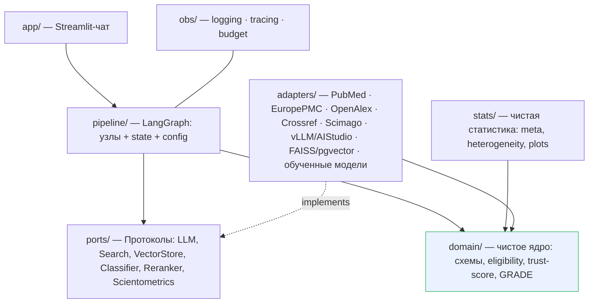
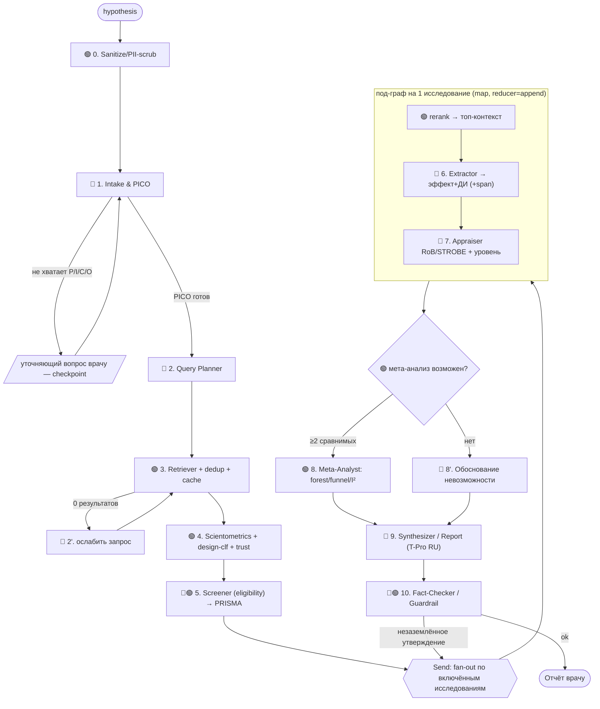

# План решения — Трек 3: AI-ассистент для научных исследований в онкологии

> Хакатон **«Цифровое здоровье»** (НМИЦ онкологии им. Н.Н. Петрова + ITMO).
> Дедлайн: **04.07.2026**. План составлен **29.06.2026** (≈ 5–6 рабочих дней).
> Репозиторий: Sourcecraft. Обучение моделей: **обязательно в Yandex Cloud**.
> **Ревизия v2** — устранены слабые места (см. §0.1).

---

## 0. TL;DR

Мультиагентная система на **LangGraph** с **слоистой (гексагональной) архитектурой**: принимает **гипотезу врача** → структурирует в **PICO** → ищет публикации (**PubMed + Europe PMC + OpenAlex**) → отбирает по критериям (**PRISMA**) → наукометрически **взвешивает доверие** → извлекает численные данные → оценивает качество (**RoB 2.0 / ROBINS-I / STROBE**) → при возможности проводит **мета-анализ** (forest/funnel, I²) → выдаёт **короткий проверяемый отчёт** с вердиктом по гипотезе, уровнем уверенности, ссылками и разделением «факт / интерпретация».

**Четыре несущих принципа:**
1. **Слои + правило зависимостей** (domain ← ports ← adapters; всё указывает внутрь) → модули независимо тестируемы и заменяемы.
2. **LLM за портом `LLMPort`** (OpenAI-совместимый) → Qwen-32B / T-Pro / YandexGPT свопаются конфигом.
3. **Детерминизм ≠ генерация** → статистика, скоринг и eligibility — чистые функции (`domain/`, `stats/`), LLM только извлекает и формулирует.
4. **Дешёвые обученные модели гейтят дорогие LLM-вызовы** — и это же «trained in YC» дельверабл.

### 0.1 Что исправлено в ревизии v2 (устранённые слабые места)

| Слабое место (v1) | Исправление (v2) | Раздел |
|---|---|---|
| God-object state + обещанная параллельность → гонки | Типизированные **каналы с reducer'ами**; узлы возвращают **частичный update**, не мутируют state | §4 |
| Trust-score **исключал** исследования + неявно «взвешенный» пулинг (метод. ошибка) | **Eligibility ≠ trust**: trust только ранжирует/влияет на GRADE и sensitivity-анализ; пулинг — **inverse-variance** | §6.2, §8 |
| «Deep modules» декларативно, без контрактов | **Порты-протоколы** + правило зависимостей + слоистая структура | §2, §4 |
| Нет оценки системы (только F1 моделей); LLM недетерминирован vs воспроизводимость | **Eval-харнесс + gold-набор + системные метрики**; `temperature=0` + **кэш ответов LLM** | §10, §9 |
| Безопасность: PII в гипотезе, **prompt-injection из абстрактов** | **Скраббинг PII** + изоляция извлечённого контента как данных | §9 |
| Смешаны детерминированные tool-узлы и LLM-узлы; реранкер как «узел графа» | Явное разделение **tool-node vs llm-node**; реранкер — часть `retrieval` | §3, §6.3 |
| Нет бюджета/таймаутов/наблюдаемости | **Budget controller + таймауты + structured logging/трейсинг** | §3, §10 |

---

## 1. Цель и критерии успеха

**Цель:** рабочий прототип-чат для врача-онколога, проходящий путь *гипотеза → проверяемый вывод* с обоснованием через систематический/мета-анализ.

Проектируем **под открытую таблицу баллов (100)** — карта «фича → баллы»:

| № | Критерий | Балл | Чем закрываем |
|---|---|---|---|
| 1 | Полнота исследовательского сценария | 15 | Сквозной граф гипотеза→отчёт (E2E) + **eval-харнесс** |
| 2 | Поиск, отбор, проверяемость источников | 15 | PubMed/EuropePMC/OpenAlex, DOI/PMID, дедуп, **верификация реальности ссылок**, причины вкл./искл. |
| 3 | Scoping review | 10 | Типы публикаций (обученный классификатор), популяции, исходы, пробелы |
| 4 | Систематический обзор | 15 | PICO, критерии eligibility, скрининг, таблица, PRISMA, оценка качества |
| 5 | Мета-анализ / проверка возможности | 10 | forest/funnel, I²/Q/τ², Egger, ДИ; либо структурное обоснование невозможности |
| 6 | Критическая оценка качества/доказательности | 10 | RoB 2.0 / ROBINS-I / STROBE + **GRADE-like** уровень + sensitivity-анализ |
| 7 | Качество ответа и снижение рисков LLM | 10 | Заземление, **провенанс**, факт/интерпретация, уровень уверенности, анти-инъекция |
| 8 | UX/UI для врача | 5 | Streamlit-чат: вопрос → источники → данные → обзор → ограничения |
| 9 | Код, архитектура, воспроизводимость | 5 | Слои, порты, Docker, пины версий, тесты, кэш, `.env.example` |
| 10 | Презентация | 5 | 5–7 мин: проблема → архитектура → демо (2 кейса) → ограничения |

**Definition of Done (минимум):** критерии 1,2,3,4,6,7,8,9 работают E2E + ≥1 обученная в YC модель + деплой + видео + green eval на gold-наборе. Мета-анализ (5) и реранкер — «Should» (§11).

---

## 2. Архитектура — слои и правило зависимостей

Гексагональная (ports & adapters) структура. **Правило:** зависимости указывают **внутрь**; `domain` не зависит ни от чего; адаптеры **реализуют** порты (инверсия зависимостей) → любой адаптер заменяется без правки логики.



**Слои:**
- **`domain/`** — чистые типы (Pydantic) и доменная логика **без I/O и LLM**: схемы (PICO, Source, Extraction, Appraisal, MetaResult, Report, Claim), `eligibility.py` (критерии включения), `scoring.py` (trust-score), `grade.py` (уровень доказательности). Полностью юнит-тестируемо.
- **`stats/`** — чистый статистический движок (мета-анализ, гетерогенность, графики). Зависит только от `domain` + numpy/statsmodels.
- **`ports/`** — Протоколы (интерфейсы): `LLMPort`, `SearchPort`, `VectorStorePort`, `ClassifierPort`, `RerankerPort`, `ScientometricsPort`.
- **`adapters/`** — конкретные реализации портов (заменяемы): источники, LLM-бэкенды, векторные хранилища, обученные модели.
- **`pipeline/`** — оркестрация LangGraph: состояние с reducer'ами, конфиг, узлы, под-граф по исследованию. Зависит от `ports` и `domain`, **не** от `adapters` (инъекция через DI/конфиг).
- **`app/`** — Streamlit. Зависит от `pipeline`.
- **`obs/`** — наблюдаемость и бюджет (cross-cutting).

> Эффект: deterministic-узлы тестируются без сети/LLM (mock портов); адаптеры — контрактными тестами с записанными фикстурами; LLM-бэкенд меняется одной строкой.

---

## 3. Пайплайн (LangGraph) — узлы и потоки

Явно различаем **🟢 deterministic tool-node** (без LLM, юнит-тестируемы) и **🔵 LLM-node** (генерация). Реранкер — не узел, а вызов внутри `retrieval`.



**Особенности оркестрации:**
- **Checkpointer** (LangGraph `MemorySaver`/`SqliteSaver`) → сессия резюмируема, human-in-the-loop уточнение не теряет state.
- **Fan-out по исследованиям** через `Send` API → под-граф `rerank→extract→appraise` исполняется параллельно по каждому включённому исследованию; результаты сливаются reducer'ом (append) — без гонок (§4).
- **Деградация:** каждый узел оборачивается в try → при ошибке источника/исследования пишет `partial`/`skipped+reason`, пайплайн продолжается (никогда не падает целиком).
- **Budget controller:** `max_candidates` (≈200), `max_deep_studies` (топ-N по eligibility+trust, ≈25), потолок токенов на сессию, **таймауты** на узел; при превышении — graceful-обрезка с пометкой в отчёте.

---

## 4. Контракты модулей (ядро модульности)

**Интерфейс узла** — единый протокол; узел **возвращает частичный апдейт**, не мутирует общий state:

```python
class Node(Protocol):
    name: str
    async def __call__(self, state: ResearchState, deps: Deps) -> StateUpdate: ...
```

`Deps` — контейнер внедрённых портов (`llm`, `search`, `vector`, `classifier`, `reranker`, `sciento`) → узлы зависят от **портов**, не от конкретных адаптеров (DI). Это и делает пайплайн модульным и тестируемым (в тестах передаём mock-`Deps`).

**Состояние с reducer'ами** (LangGraph `Annotated` каналы — безопасный конкурентный апдейт):

```python
class ResearchState(TypedDict):
    raw_hypothesis: str
    pico: PICO | None
    queries: list[Query]
    candidates: Annotated[list[Source], dedup_reducer]       # дедуп при слиянии
    screening: Annotated[list[ScreenDecision], operator.add]
    prisma: PrismaCounts
    extractions: Annotated[list[Extraction], operator.add]   # append из fan-out
    appraisals: Annotated[list[Appraisal], operator.add]
    meta: MetaResult | Infeasible | None
    report: Report | None
    provenance: Annotated[list[Claim], operator.add]
    audit: Annotated[list[Event], operator.add]
```

**Порты (Protocols):**

```python
class LLMPort(Protocol):
    async def complete(self, msgs, *, schema=None, temperature=0.0, role="primary") -> Any: ...
class SearchPort(Protocol):
    async def search(self, q: Query) -> list[Source]: ...
class ClassifierPort(Protocol):
    def predict(self, texts: list[str]) -> list[Label]: ...
# + VectorStorePort, RerankerPort, ScientometricsPort
```

**Config-driven пайплайн** (`pipeline/config.py`, pydantic-settings) — фич-флаги для MoSCoW-деградации:

```
PipelineConfig:
  models: {primary, ru, reasoning}      # id под LLMPort
  vector_backend: faiss | pgvector
  enable_meta_analysis: bool
  enable_reranker: bool
  max_candidates: int = 200
  max_deep_studies: int = 25
  language_out: "ru"
```

> Любую стадию можно включить/выключить конфигом → демонстрируемая модульность и плавная деградация под время.

---

## 5. Стратегия LLM (порт `LLMPort`)

Один порт, OpenAI-совместимые адаптеры (vLLM и AI Studio оба говорят в формате OpenAI):

| Роль | Модель | Где | Зачем |
|---|---|---|---|
| **primary** (intake, query, extract, screen) | **Qwen2.5-32B-Instruct** / **Qwen3-30B-A3B** | vLLM на YC GPU | tool-use, строгий JSON, 128k контекст |
| **ru** (synthesizer) | **T-Pro-it-1.0** (32B, Qwen-based) | vLLM на YC GPU | лучший открытый русский |
| **fallback** (zero-ops) | **YandexGPT 5 Pro** | AI Studio API | если GPU/время поджимают |
| **reasoning** (appraiser, опц.) | **DeepSeek-R1-Distill-Qwen-32B** / **QwQ-32B** | vLLM на YC GPU | глубокая оценка доказательности |

- Свитч: `LLM_PRIMARY/LLM_RU/LLM_REASONING` в `.env`.
- **Сайзинг:** 32B bf16 ≈ 1×A100-80GB; AWQ-4bit ≈ 40–48GB; скромная квота → Qwen2.5-14B / T-Lite-8B.
- **Не используем внешний API DeepSeek** (data residency мед-данных).
- **Детерминизм:** `temperature=0`, `seed` где поддержано, + **кэш ответов** (`hash(model,prompt,params)→response`) → повторный прогон воспроизводим (критерий 9) и дешевле.
- **Гигиена:** `response_format=json` + валидация Pydantic + ретрай при невалидной схеме; промпты по ролям в `adapters/llm/prompts/`.

---

## 6. Поиск и наукометрия

### 6.1 Источники

| Источник | API | Что берём | Ключ |
|---|---|---|---|
| **PubMed** | E-utilities | PMID, абстракт, **Publication Types**, MeSH, журнал | NCBI API key (беспл., ↑rate) |
| **Europe PMC** | REST | full-text для OA, цитирования | — |
| **OpenAlex** | works/sources | цитируемость, venue, OA, концепты | polite pool (email) |
| **Crossref** | REST | метаданные DOI, **флаг ретракции** | — |
| **Scimago SJR** | CSV (в репо) | **квартиль журнала** Q1–Q4 | офлайн |

**Язык:** запросы/извлечение — EN (абстракты англоязычные); отчёт — RU. Эмбеддинги мультиязычные (**bge-m3**) → русская гипотеза матчит английские пассажи. Перевод терминов через MeSH-маппинг + валидация «запрос дал >0».

### 6.2 Eligibility ≠ Trust (важное методическое разделение)

- **Eligibility (Screener, §3 узел 5):** бинарное вкл./искл. по **PICO-соответствию + заданным критериям типа исследования + ретракция**. Recall-ориентировано (не терять РКИ). Формирует **PRISMA**.
- **Trust score:** применяется к **уже включённым** → влияет на (a) порядок/акцент в нарративе, (b) **GRADE-уровень**, (c) **sensitivity-анализ** (leave-one-out, исключение high-RoB). **Не исключает** исследования (кроме ретракций) и **не задаёт веса пулинга** — иначе систематическое смещение обзора.

**Trust score (0–100, прозрачная разбивка в UI):**
```
trust = design(0–35) + quartile(0–25) + citation(0–20) + recency(0–10) + sample(0–10) − penalties
```
design (из обученного классификатора): SR/MA 35 · RCT 28 · prospective cohort 21 · case-control 14 · cross-sectional 10 · case series 6 · case report 3 · expert 0 · quartile (SJR): Q1 25…Q4 4 · citation (OpenAlex, log-норм) 0–20 · recency (decay ~10 лет) · sample (log N) · penalties: retracted→исключить, predatory −20, preprint −10 (флаг).

### 6.3 RAG (модуль retrieval, не узел графа)

Чанкинг абстракт (+OA full-text) → **bge-m3** (dense+sparse) → **гибрид BM25+dense** → **обученный reranker** (bge-reranker-v2-m3) → топ-контекст. Хранилище: локальный **FAISS/Chroma** (старт) → опц. **Managed PostgreSQL + pgvector** в YC.

---

## 7. 🎓 Обучение в Yandex Cloud (закрываем главное ограничение)

Обучаем **малые модели** в **DataSphere**, чекпойнты — в **Object Storage**, инференс — через адаптеры `ClassifierPort`/`RerankerPort`.

| # | Модель | Разметка | База | В пайплайне | Цель |
|---|---|---|---|---|---|
| **A ⭐** | Классификатор дизайна (9 классов) | **Бесплатно**: PubMed Publication Types + MeSH | `PubMedBERT`/`e5-base` | trust (6.2), scoping (3), appraisal (6) | macro-F1 ≥ 0.85 |
| **B** | Реранкер (cross-encoder) | (query, rel-abstract) из ко-цитирования / MS MARCO-med | `bge-reranker-v2-m3` | RAG (2,7) | nDCG@10 ↑ |
| **C** | Скрининг (include/exclude) | seed от LLM + SR-датасеты (CLEF/SYNERGY) | bi-encoder + LR | eligibility (4) | recall ≥ 0.95 |

**A — «герой»:** метки готовы из метаданных PubMed (efetch с онко-фильтром), обучение минуты, бьёт в 3 критерия. **Дельверабл:** `training/*.ipynb` + датасеты/чекпойнты в Object Storage + отчёт метрик (показываем на питче). **Приоритет:** A → B → C.

---

## 8. Мета-анализ (детерминированный, `stats/`)

**Gate возможности:** ≥2 исследования, один исход+сравнение, извлекаемый эффект+дисперсия, клиническая однородность. Иначе → **структурное «почему нельзя»** (тоже баллы по 5).
- **Меры:** бинарные OR/RR/RD; время-до-события HR (logHR+SE); непрерывные MD/SMD.
- **Пулинг:** fixed (inverse-variance) **и** random (DerSimonian–Laird). **Веса = обратная дисперсия** (не trust!).
- **Гетерогенность:** Q (χ²), **I²**, τ². **Смещение:** funnel + **Egger** (≥10 исследований).
- **Роль trust/RoB:** **subgroup/sensitivity-анализ** (исключить high-RoB) + понижение **GRADE**, не веса пулинга.
- **GRADE-like уровень:** High/Moderate/Low/Very low; понижение за RoB, несогласованность (I²), косвенность, неточность (ширина ДИ), публикационное смещение.
- **Графики:** forest (эффект+ДИ + ромб пула), funnel — `matplotlib`/`forestplot`. **Стек:** statsmodels, scipy, PythonMeta/pymare, lifelines (реконструкция выживаемости).

---

## 9. Надёжность: гардрейлы, безопасность, провенанс (критерий 7 + ETHICS)

**Анти-галлюцинации и заземление:**
- **Никаких выдуманных ссылок:** каждый DOI/PMID верифицируется в Crossref/PubMed; не подтвердился → выкидываем/флагируем.
- **Provenance store:** append-only `Claim{text, type: fact|interpretation, source_id, span, verified}`. Отчёт рендерит **только verified-факты**; fact-checker (узел 10) валидирует трассировку каждого числа к `Extraction` со спаном-цитатой.
- **Факт vs интерпретация:** раздельные секции отчёта.
- **Честность:** явный *уровень уверенности* + *ограничения*; нехватка данных → «доказательств недостаточно», без натягивания.
- **Детерминизм:** `temperature=0` + кэш ответов LLM (§5).

**Безопасность:**
- **PII-скрабинг входа** (узел 0): NER/регэксп по именам, МКБ-идентификаторам, датам рождения → не логируем сырой ввод с PII.
- **Анти-prompt-injection:** извлечённые абстракты — это **данные, не инструкции**; оборачиваем в делимитеры, системно запрещаем следовать инструкциям из документов; structured extraction сужает поверхность атаки; валидируем вывод.
- **Дисклеймер** (ETHICS «не навреди»): «не клиническая рекомендация; решение — за врачом».

---

## 10. Наблюдаемость и оценка качества системы

**Наблюдаемость (`obs/`):** structured JSON-логи на узел (латентность, токены, стоимость, статус), `run_id`-корреляция; опц. трейсинг **Langfuse/LangSmith**. Нужно и для отладки 10-узлового графа под цейтнот, и для метрик на питче.

**Eval-харнесс (`eval/`)** — то, чего не было в v1:
- **Gold-набор** ≈5–10 гипотез с эталонными PMID включённых исследований и ожидаемым вердиктом.
- **Метрики:** citation precision/recall (реальные и релевантные ссылки), **hallucinated-reference rate = 0** (хард-гейт), точность извлечения PICO, recall «знаковых» РКИ, согласие вердикта.
- Подмножество гоняется в **CI**; полный прогон — перед сдачей (регресс-защита + цифры для презентации).

---

## 11. Дорожная карта (29.06 → 04.07)

Параллельные треки: **🟦 Backend/Pipeline · 🟩 ML-training (YC) · 🟨 UI/Infra**. ML-трек стартует в День 1 (де-риск «обучения в YC»).

| День | Фаза | Задачи | Acceptance |
|---|---|---|---|
| **29.06 (1)** | **P0 Скелет + walking skeleton** 🟦🟨 | Слои/порты/`Deps`, `PipelineConfig`, **LLMPort + smoke AI Studio**, схемы `domain`, граф из заглушек (hypothesis→stub report) с reducer'ами, **structured logging**, `docker compose` smoke зелёный, заготовка `eval/`. **🟩 Сборка датасета модели A (efetch).** | E2E на заглушках; контейнер exit 0; 1 gold-кейс гоняется |
| **30.06 (2)** | **P1 Поиск + P2 Наукометрия** 🟦 | Адаптеры PubMed/EuropePMC/OpenAlex + дедуп + **content-addressed cache**; bge-m3 + гибрид; SJR-lookup; trust-score (`domain/scoring`); Screener+PRISMA. **🟩 Обучение модели A в DataSphere → метрики.** | Реальные источники с DOI/PMID; **модель A обучена**; eligibility отделён от trust |
| **01.07 (3)** | **P3 Извлечение + Оценка** 🟦 | Под-граф `rerank→extract→appraise` (fan-out, append); structured extraction (эффект+ДИ+span); RoB/ROBINS-I/STROBE; GRADE (`domain/grade`); интеграция A. **🟩 реранкер B (если успеваем).** | Таблица исследований + оценка качества по каждому |
| **02.07 (4)** | **P4 Мета-анализ + P5 Гардрейлы** 🟦 | `stats/`: пулинг (inverse-variance), I²/Q, forest/funnel, Egger; gate; synthesizer (T-Pro); fact-checker (верификация DOI, provenance, факт/интерпретация); **PII-скрабинг + анти-инъекция**. | forest/funnel; ссылки верифицируются; вердикт; hallucination-rate=0 |
| **03.07 (5)** | **P6 UI + P7 Деплой** 🟨 | Streamlit-чат + вкладки (источники/таблица/графики/PRISMA/ограничения + бары trust); деплой в YC; Sourcecraft CI (build+ruff+pytest+eval-subset); README/docs/`.env.example`/DEPLOY; **пины версий**. | Живое демо в YC; `docker compose run --rm app` → отчёт, exit 0 |
| **04.07 (6)** | **P8 Харденинг + Презентация** | Полный eval-прогон, 2 демо-кейса, видео 5–7 мин, dry-run «ИИ-судьи», тег. | Сдача готова, воспроизводимо, eval зелёный |

**MoSCoW:**
- **Must:** слои+порты, E2E, проверяемые источники, eligibility+PRISMA, извлечение, оценка качества, отчёт+гардрейлы+PII, **модель A**, eval-харнесс, UI, деплой, docs.
- **Should:** полный мета-анализ, реранкер B, трейсинг.
- **Could:** скрининг-классификатор C, full-text mining, pgvector.
- **Won't (сейчас):** дообучение генеративной LLM, мультиязычный UI.

**Критический путь:** P0 → P1 → P3 → P6 → деплой. Мета-анализ и B/C — вне критического пути (деградируют через `PipelineConfig`).

---

## 12. Структура репозитория (целевая, по слоям)

```
src/
  domain/        # ЧИСТОЕ ядро (без I/O): schemas.py, eligibility.py, scoring.py, grade.py
  stats/         # чистая статистика: meta.py, heterogeneity.py, plots.py
  ports/         # Протоколы: llm, search, vectorstore, classifier, reranker, scientometrics
  adapters/
    llm/         # vllm_client, aistudio_client, cache, prompts/
    search/      # pubmed, europepmc, openalex, crossref, scimago, cache
    vectorstore/ # faiss, pgvector
    models/      # обученные: design_classifier, screener, reranker
  pipeline/
    state.py     # ResearchState + reducers
    config.py    # PipelineConfig (фич-флаги)
    deps.py      # сборка Deps (DI портов)
    graph.py     # build_graph + checkpointer
    substudy.py  # под-граф на исследование
    nodes/       # intake, query_planner, retriever, scientometrics, screener,
                 # extractor, appraiser, meta_analyst, synthesizer, factchecker, sanitize
  obs/           # logging, tracing, budget
  app/           # streamlit (заменяет заглушку main.py)
training/        # DataSphere: build_design_dataset.py, train_*.ipynb
eval/            # gold/*.yaml, run_eval.py, metrics.py
data/            # raw/  processed/cache/  scimago/(csv)
docs/ tests/ deploy/   DEPLOY.md docker-compose.yml Dockerfile .env.example
```

---

## 13. Технологический стек

Python 3.11 · **LangGraph** + LangChain core · Pydantic v2 / pydantic-settings · **vLLM** (OpenAI-совм.) + `openai` клиент, AI Studio fallback · sentence-transformers / FlagEmbedding / transformers+peft (трейн) · httpx + FAISS/Chroma/pgvector + rank-bm25 · statsmodels/scipy/PythonMeta/pymare/matplotlib/forestplot/lifelines · **Streamlit** · Docker/compose, деплой в YC · pytest + ruff + **VCR-фикстуры** + **uv/pip-tools lock** · structured logging + опц. Langfuse.

---

## 14. Деплой и воспроизводимость

- **Демо:** Streamlit на YC Compute VM (GPU под vLLM) / Serverless Container; интернет есть → живой PubMed.
- **ИИ-судья:** `docker compose run --rm app` → **canned smoke-сценарий** (зашитая гипотеза, **кэш-данные**, LLM через AI Studio) → отчёт, exit 0. Без GPU и сети.
- **DEPLOY.md** — реальные критерии («отчёт сформирован, ссылки проверены, hallucination-rate=0»).
- **Секреты** (NCBI key, YC ключи) — Sourcecraft secrets / `.env` (не в гит). **Версии пиннятся** (lock-файл) — критерий воспроизводимости.
- **Sourcecraft CI:** build → ruff+pytest → eval-subset → smoke. *(Точную схему YAML уточнить — §16.)*

---

## 15. Риски и митигации

| Риск | Митигация |
|---|---|
| Нет/мала GPU-квота | Фоллбэк YandexGPT 5 Pro + 4-bit + 14B/8B |
| Rate-limit/падение PubMed | NCBI key, бэкофф, **content-addressed cache**, офлайн-демо |
| Галлюцинации ссылок/чисел | Верификация DOI/PMID, provenance, structured output + валидация |
| **Prompt-injection из абстрактов** | Контент = данные; делимитеры; запрет инструкций из документов; валидация |
| **Недетерминизм LLM vs воспроизводимость** | `temperature=0` + кэш ответов + lock версий + gold-eval |
| **Метод. смещение обзора** | eligibility ≠ trust; пулинг по дисперсии; sensitivity-анализ |
| Мало данных для мета-анализа | Gate + честное «невозможно» с обоснованием |
| JIF лицензируемый | Открытые OpenAlex + Scimago SJR (честно называем) |
| Цейтнот | MoSCoW + walking skeleton с Дня 1 + параллельный ML-трек + фич-флаги |

---

## 16. Открытые вопросы (проверить в начале Дня 1)

1. **YC-ресурсы** ([console.yandex.cloud](https://console.yandex.cloud)): folder_id → `YANDEX_FOLDER_ID`; AI Studio доступен и что в меню моделей (есть ли Qwen); DataSphere включён + GPU-квота (тип/число); сервисный аккаунт + роль `ai.languageModels.user` → `YANDEX_API_KEY`; Billing активен.
2. **AI Studio меню** — есть ли Qwen/DeepSeek-distill из коробки (иначе self-host vLLM).
3. **Sourcecraft CI** — точный путь/схема pipeline-файла.
4. **Корпус** — живой PubMed или офлайн-набор от организаторов (сейчас `data/raw` пуст).
5. **NCBI API key** — зарегистрировать (беспл., до 10 rps).

---

## 17. Приложение

**Демо-кейсы:** (1) «богатая база» — анти-PD-1 vs химия при метастатической меланоме (OS) → полный мета-анализ с forest plot; (2) «разреженные данные» → честное «доказательств недостаточно» (показывает анти-галлюцинационную честность).

**Глоссарий:** PICO · РКИ · RoB 2.0 / ROBINS-I / STROBE · GRADE · I²/Q/τ² · SJR · PRISMA.

**Принципы кода:** слои + правило зависимостей внутрь; порты-протоколы + DI; детерминизм отделён от генерации; чистое ядро без I/O; всё сетевое и LLM-ответы кэшируются (воспроизводимость); обученные модели гейтят дорогие LLM-вызовы; одна конфигурация переключает модели и стадии.

---

*Документ живой: уточняем §16 в начале Дня 1, дальше — дорожная карта §11.*
